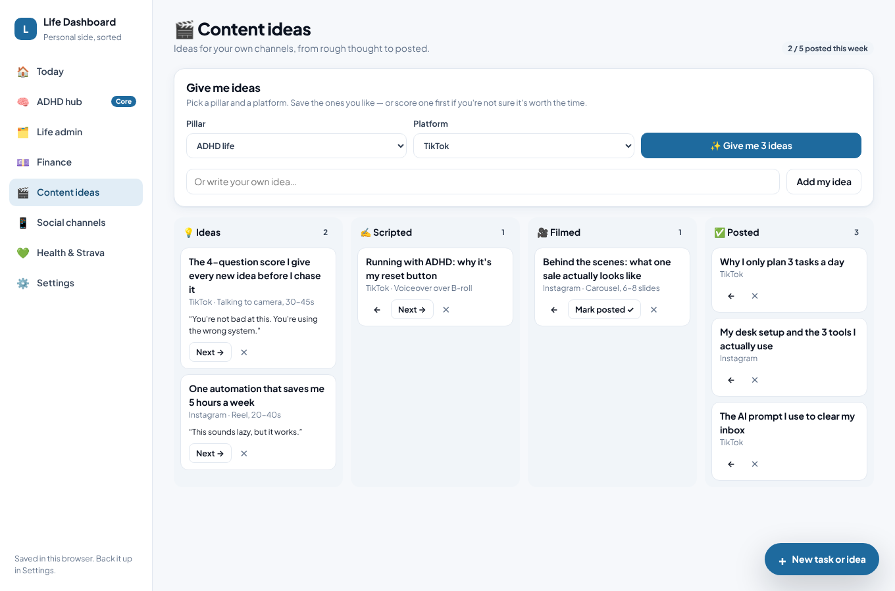

# Life Dashboard (personal side)

A personal dashboard that sits apart from the business system. It covers the ADHD hub, life admin, finance, content ideas, social channels, and health with Strava.

- **Open it:** `/life` on the running server (for example `http://localhost:3000/life`). You can also open `public/life/index.html` straight from your computer or phone.
- **One file, no build:** everything is in `public/life/index.html`.
- **Your data:** it's saved in the browser you use, on that device only. Use **Settings → Export backup** to keep a copy, and **Import backup** to move it to another device.
- **First run:** choose **Start fresh**, or **Explore with example data** to see it filled in. You can clear the example data from Settings.


## 🧠 ADHD hub (the core)

It has six tabs, kept separate:

| Tab | What it does |
|---|---|
| **How I'm doing** | A daily score from 1 (really rough) to 10 (flying), plus optional energy (1–5), sleep, tags and a note. It shows a daily line chart (7/14/30 days), weekly averages for the last 8 weeks, your check-in streak, and **Patterns** (how your score changes on days tagged "Slept well", "Exercised", "Overwhelmed" and so on). |
| **Score & sort** | Score a task or idea *before* you add it. Four toggles (Impact, Urgency, Energy fit, Effort) give a live score from 0 to 100 and a verdict: **Do it now**, **Schedule it** or **Park it**. Below it are the three buckets, where you can tick tasks off, move them or rescore them. |
| **Today's 3** | At least three tasks every day, with one always for your health. They're matched to today's check-in: on a low-energy day you get quick, gentle wins. If you haven't scored enough tasks, it suggests a simple health or admin task. |
| **Deep focus** | A 15–90 minute timer linked to a task. It logs your deep-focus hours. If a distracting thought comes up mid-session, type it in and it goes to the brain dump. |
| **Weekly wins** | **Time saved**, **problems solved**, **deep focus hours** and **ideas parked, not chased**, each compared with last week. It also lists your wins and parked ideas, shows time saved week by week, and has a two-minute reflection. |
| **Brain dump** | Get it out of your head now and score it later. You can also park an item in one tap. |

### The formula

Each toggle runs from 1 to 5:

```
Score = ((Impact×40 + Urgency×30 + Energy fit×20 + (6 − Effort)×10) ÷ 100 − 1) ÷ 4 × 100

Score 70 or more  → Do it now
Score 45 to 69    → Schedule it
Below 45          → Park it
```

Two overrides apply whatever the score:

- Urgency 5 with impact 4 or more always goes to **Do it now**.
- Impact and urgency both 2 or less always gets **parked**.

You can change the weights and the score thresholds in **Settings → Your scoring formula**.

### How the weekly numbers are worked out

- **Time saved:** each idea you park gets credited with the time its effort score says it would have taken (1 = 15 min, 2 = 1h, 3 = 2h, 4 = 4h, 5 = 8h).
- **Problems solved:** tasks ticked off this week.
- **Deep focus:** minutes logged with the focus timer.
- **Ideas parked, not chased:** ideas parked this week that are still parked.

| Check-in | Score & sort |
|---|---|
|  |  |

| Weekly wins | Deep focus |
|---|---|
|  |  |

## The other sections

- **🗂️ Life admin:** home, admin and money tasks, grouped into overdue, today, next 7 days, later and no date. Tasks can repeat weekly, monthly or yearly, and the next one is created when you tick one off. Bills from Finance show here too.
- **💷 Finance:** money in and out, monthly budgets for each category (with warnings at 85% and when you go over), a 6-month spending trend, bills and subscriptions by the day they come out, and savings goals.
- **🎬 Content ideas:** pick a pillar and a platform to get 3 ideas, each with a hook, format and call to action. Save them, or score one first. A board takes each idea from Idea → Scripted → Filmed → Posted, with a weekly posting goal.
- **📱 Social channels:** every channel with its follower count, change over 30 days, a sparkline, and posts this week.
- **💚 Health & Strava:** weekly distance for the last 8 weeks, recent activities, daily basics (habits you choose) and average sleep taken from your check-ins.
  - **To import Strava:** go to Strava → Settings → My Account → *Download or delete your account* → request your archive. Then import `activities.csv`. Activities you've already imported are skipped.

| Finance | Content ideas |
|---|---|
|  |  |


## Next steps

1. **Sync across devices.** Save the data to the CM Automations server behind a personal sign-in, so your phone and laptop share it.
2. **Live Strava.** Strava's secure sign-in needs a server, so add it to the server with an automatic weekly import.
3. **Live follower counts.** Take them from the API hub's TikTok, Instagram and YouTube connections.
4. **Bank feed.** Use open banking, or import a bank CSV, so you don't have to type in what you spend.
5. **AI content ideas.** Use the assistant (the same Claude set-up as Content Studio) for ideas written in your own voice.
6. **Reminders.** A morning text or WhatsApp with Today's 3, and a Sunday-evening weekly wins summary.
