# Life Dashboard (personal side)

A personal dashboard that sits apart from the business system. It covers the ADHD hub, life admin, finance, the content hub, social channels, and health with Strava.

- **Open it:** `/life` on the running server (for example `http://localhost:3000/life`). You can also open `public/life/index.html` straight from your computer or phone.
- **One file, no build:** everything is in `public/life/index.html`.
- **Your data:** it's saved on the device you're using, so it works offline. Sign in under **Settings → Sync** (or from the welcome screen) and your phone and laptop share one copy. See [Sync](#-sync-between-phone-and-laptop). **Export backup** still works too.
- **First run:** choose **Start fresh**, or **Explore with example data** to see it filled in. You can clear the example data from Settings.

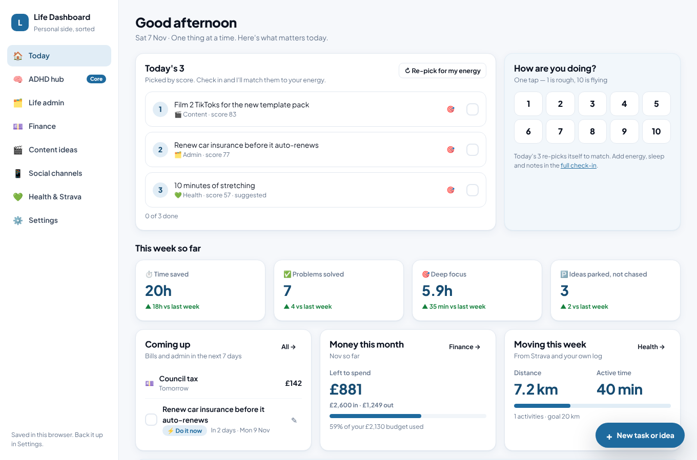

## ☁️ Sync between phone and laptop

Open the dashboard from your server address (e.g. `https://your-app.onrender.com/life`) on each device. Then sign in once with your CM Automations email and password. The welcome screen has a sign-in box, or use **Settings → Sync**.

**How it works**
- **The device is the working copy.** Everything still works offline.
- **Changes go up** about 1.5 seconds after you make them.
- **Your other devices' changes come in** every 45 seconds, when you switch back to the tab, and when you come back online.
- **If both devices changed things while apart,** they're merged record by record against the last synced copy. A task added on each device keeps both, a delete on one removes it on the other, and an edit on one shows on the other. If both changed exactly the same thing, the device saving last wins.
- **Signing in a device that already has its own dashboard** asks what to do: **Merge both** (recommended), **Use my account's dashboard**, or **Use this device's dashboard**. A brand-new device just takes your account's dashboard.
- **The sidebar shows the sync status:** "Synced 2 min ago · iPhone", or an offline or signed-out warning.
- **Private to you:** the dashboard belongs to you (your user), not the business, so nobody else on the business account can see it.
- **Clearing everything or loading example data** while sync is on also changes your other devices. The confirm message says so.

**Social channels ↔ API hub**
- On each channel in **Social channels**, pick its TikTok, YouTube or other stream from **🔗 Link to an API hub stream**.
- Follower or subscriber counts then stay in step both ways. A count you update in the dashboard is recorded in the API hub, and figures added in the hub (by hand, by CSV or through its web address) come into the dashboard on your phone and laptop.
- TikTok and Instagram don't share follower counts with other apps, so the count still comes from you or from an automation. It just only needs entering once.

**On the server:**

| Route | What it does |
|---|---|
| `GET` / `PUT /api/life/state` | The synced copy and its version. A save from a device that's behind gets `409` and the latest copy to merge. |
| `GET /api/life/socials` | Follower history from the API hub |
| `POST /api/life/socials/:streamId` | Records a count in the hub |

The data is stored in the `life_state` table, one row per user, with a limit of 8 MB.

| Sync on | Signing in a device that already has data |
|---|---|
| 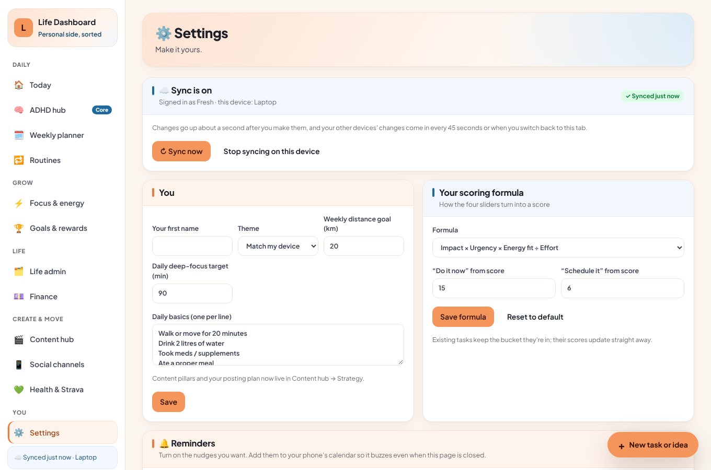 | 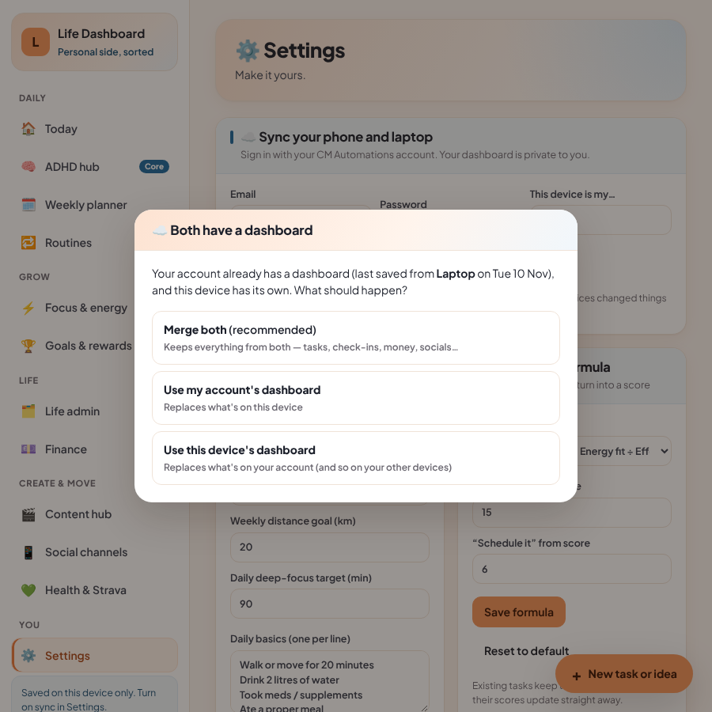 |

## 🎯 Task manager with a 1–5 importance bar

Every section except Finance has its own ranked task manager:

| Section | What it lists |
|---|---|
| **Today** | Your top 6 priorities from every area |
| **ADHD hub → Task manager** | Every task from every area, with area filters |
| **Life admin** | Admin, home and money jobs |
| **Content hub → Content tasks** | Filming, editing and posting jobs |
| **Social channels** | Replies, bio updates and collabs |
| **Health & Strava** | Appointments and training |

- **Ranking:** slide the bar from **1 (least important)** to **5 (most important)**. The list re-sorts as soon as you let go: 5s at the top, 1s at the bottom, each under its own heading.
- **Adding:** type the task, set the bar, add a date if it has one, then press **Add** or Enter.
- **Starting rank:** tasks added through the scorer start at the ranking their formula score suggests (score ÷ 20, rounded up). You can slide them anywhere after that.
- **Effect on Today's 3:** your ranking feeds into Today's 3, alongside the formula score and due dates.

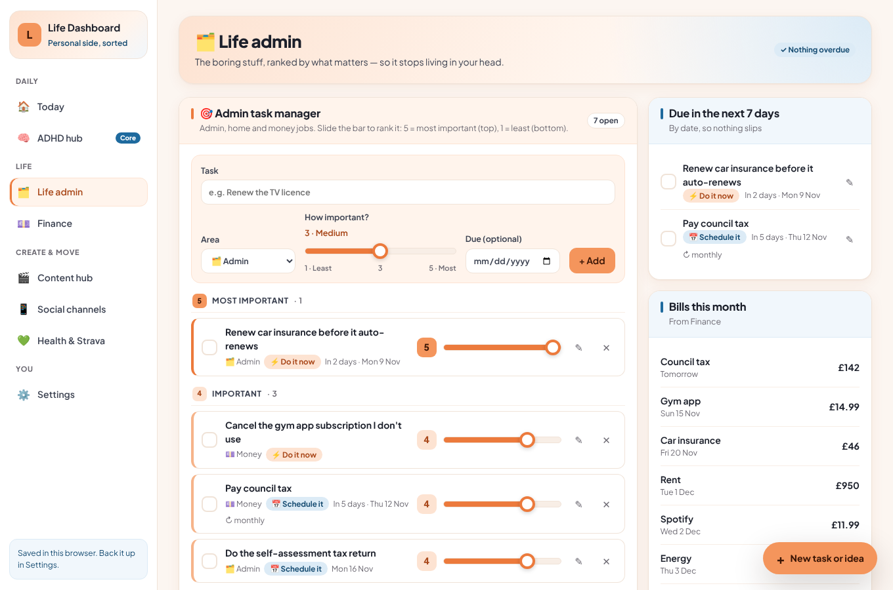

## How it's laid out

| Group | Sections |
|---|---|
| **Daily** | Today · 🧠 ADHD hub (with 🌿 Mind & reset inside it) · 🗓️ Weekly planner · 🔁 Routines |
| **Grow** | ⚡ Focus & energy · 🏆 Goals & rewards |
| **Life** | Life admin · Finance |
| **Create & move** | Content hub · Social channels · Health & Strava |
| **You** | Settings, including reminders |

**Consistency is the thread through all of it.**
- A **😵‍💫 Got distracted? Back on track** button sits on the Today page, on the pinned Today's 3 and in Focus & energy.
- It asks how long you were away and what pulled you off, with no guilt.
- Then you pick the task you were on and a 2-minute next step, and it starts a 10-minute restart.
- Every comeback is logged, earns 10 points, and feeds the "what pulls you away" patterns.

## 🧠 ADHD hub (the core)

A switch at the top flips between the **ADHD hub** and its subsection **🌿 Mind & reset**. **Today's 3 is pinned at the top of both**, with tick boxes, a focus button for each task, Re-pick, and Back on track.

The ADHD hub has seven tabs, kept separate:

| Tab | What it does |
|---|---|
| **How I'm doing** | A daily score from 1 (really rough) to 10 (flying), plus optional energy (1–5), sleep, tags and a note. It shows a daily line chart (7/14/30 days), weekly averages for the last 8 weeks, your check-in streak, and **Patterns** (how your score changes on days tagged "Slept well", "Exercised", "Overwhelmed" and so on). |
| **Productivity** | Your daily score out of 100 and how it's made up, time saved today and this week, up or down compared with your usual and last week, and tips to boost today and this week. |
| **Score & sort** | Score a task or idea *before* you add it. The formula is shown at the top. Four sliders (Impact, Urgency, Energy fit, Effort) show the sum (e.g. `4 × 3 × 4 ÷ 4`), a live score and a verdict: **Do it now**, **Schedule it** or **Park it**. Below it are the three buckets, where you can tick tasks off, move them or rescore them. |
| **Task manager** | Every task from every area, ranked 5 → 1 with the importance bar. Filter by area. |
| **Deep focus** | A 15–90 minute timer linked to a task. It logs your deep-focus hours. If a distracting thought comes up mid-session, type it in and it goes to the brain dump. Tap **📵 I got distracted** to count distractions during a session. |
| **Weekly wins** | **Time saved**, **problems solved**, **deep focus hours** and **ideas parked, not chased**, each compared with last week. It also lists your wins and parked ideas, shows time saved week by week, and has a two-minute reflection. |
| **Brain dump** | Get it out of your head now and score it later. You can also park an item in one tap. |

**Today's 3** (pinned) gives at least three tasks every day, with one always for your health.
- They're matched to today's check-in: on a low-energy day you get quick, gentle wins.
- Your weekly priorities come up on their day.
- The task you picked in last night's evening shutdown goes first.

### 🌿 Mind & reset (inside the ADHD hub)

| Tab | What it does |
|---|---|
| **SOS & back on track** | **Start a 2-minute reset** runs four steps. First, rate how overwhelmed you are (1–5). Second, breathe with a circle for 60 seconds. Third, empty your head into the brain dump. Fourth, pick one tiny task for a 10-minute go, or choose to rest. It then rates you again and shows how much the reset helps on average. **I'm back — get me on track** runs the comeback flow. Tiles show comebacks this week, the % back within 30 minutes, average time away and your biggest pull, with a tip for it. **What helps me reset** is your own list, with a "Pick one" button. |
| **Mood, triggers & meds** | Log your mood (1–5) with triggers (poor sleep, too many tasks, money worry…) and see which triggers come up most and your average mood with each. **Medication:** log it in one tap and rate how well it worked later. Shows the days you took it this week, its average effect, and productivity on days you took it compared with days you didn't. This is tracking only: talk to your GP or prescriber about anything medical. |
| **Wins jar** | Everything you've done, kept in one place: tasks, comebacks, routines, milestones and weekly resets, plus wins you add yourself. **Pull a random win** for when your head says you never get anything done. |

### The formula

Each slider runs from 1 to 5:

```
Score = Impact × Urgency × Energy fit ÷ Effort

15 or more   → Do it now
6 or more    → Schedule it
Below 6      → Park it
```

For example, 4 × 3 × 4 ÷ 4 = 12.0, which goes to **Schedule it**. Scores run from 0.2 (1 × 1 × 1 ÷ 5) to 125 (5 × 5 × 5 ÷ 1).

In **Settings → Your scoring formula** you can change the cut-offs. You can also switch back to the older weighted score out of 100, which has its own weights, cut-offs and two overrides.

### 📈 Productivity and time saved

The **ADHD hub → Productivity** tab, with a short version on the Today page, tracks how productive each day and week is and how much time you saved.

**The daily productivity score (out of 100)** is made of five parts. The tab shows each part, so you can always see why the score moved.

| Part | Points | Full marks when |
|---|---|---|
| Today's 3 | 35 | all 3 are done that day (if a day had no Today's 3, any 3 tasks count) |
| Deep focus | 25 | you reach your daily focus target (90 min by default, set in Settings) |
| Tasks ticked off | 20 | 3 or more tasks done on top of Today's 3 |
| Daily basics | 15 | every basic is ticked |
| Checked in | 5 | you've done that day's check-in |

**Up or down**
- **Today:** compared with your usual, which is the average of the previous 7 days. It's labelled "so far today", because the day isn't over yet.
- **This week:** the average daily score so far, compared with last week, in points and %.
- **Week by week:** a table of the last 8 weeks with the change each week.

**Time saved per day** is the ideas you parked that day plus a daily share (÷ 7) of what your systems save each week. Time saved per week is the same as in Weekly wins.

**Tips**
- **Boost today** looks at what's left today, such as overdue tasks, unfinished Today's 3, focus minutes, your check-in, daily basics, the brain dump and an overloaded Do it now list. Each tip shows the points it's worth and has a button to act on it.
- **Boost this week** looks at:
  - whether productivity is up or down;
  - the part of your score dragging you down most;
  - your strongest and weakest days over the last 4 weeks;
  - the content job that still takes the most time;
  - how many ideas you've parked;
  - the check-in tag that lifts your mood most.

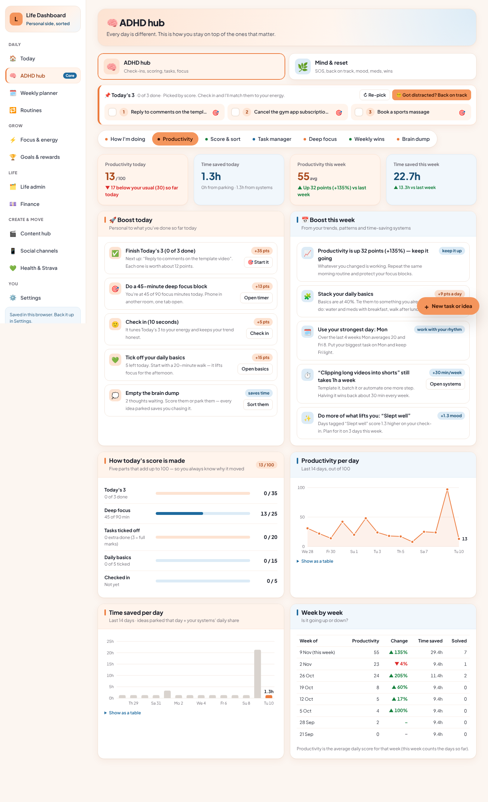

| Mind & reset | Weekly reset |
|---|---|
| 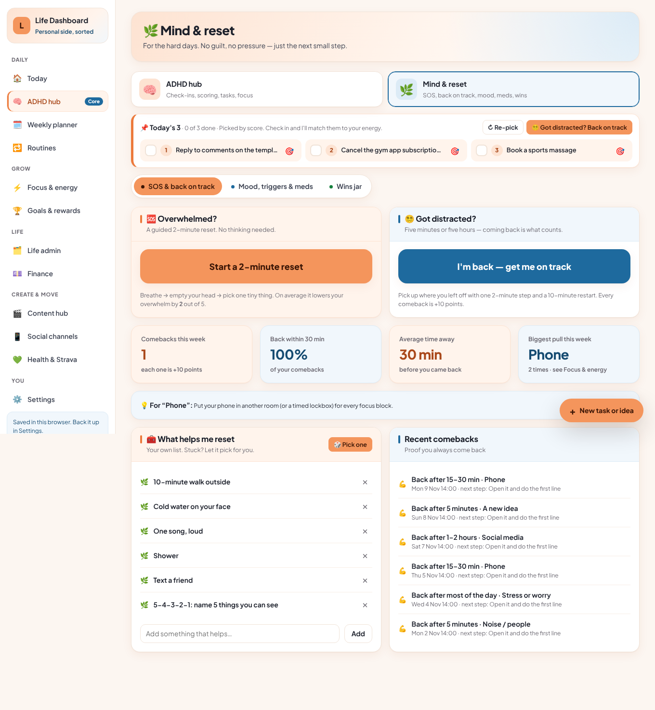 | 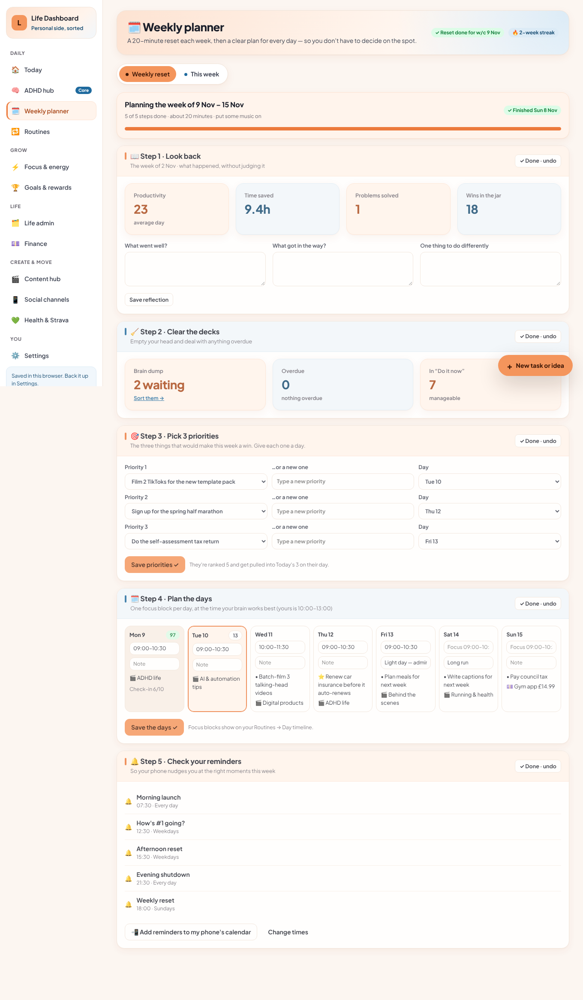 |

| Routines | Focus & energy |
|---|---|
| 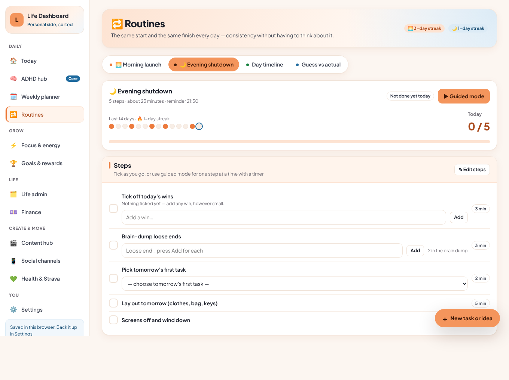 | 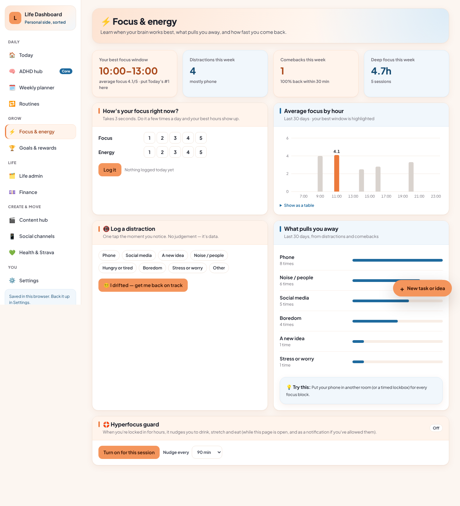 |

| Goals | Rewards |
|---|---|
| 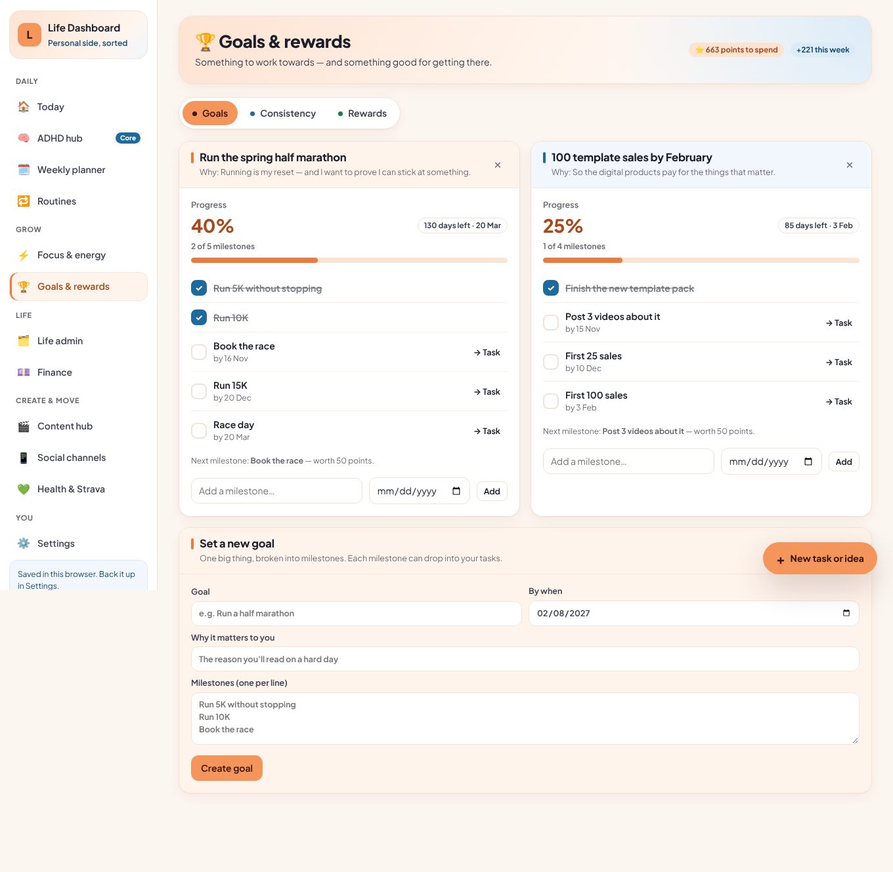 | 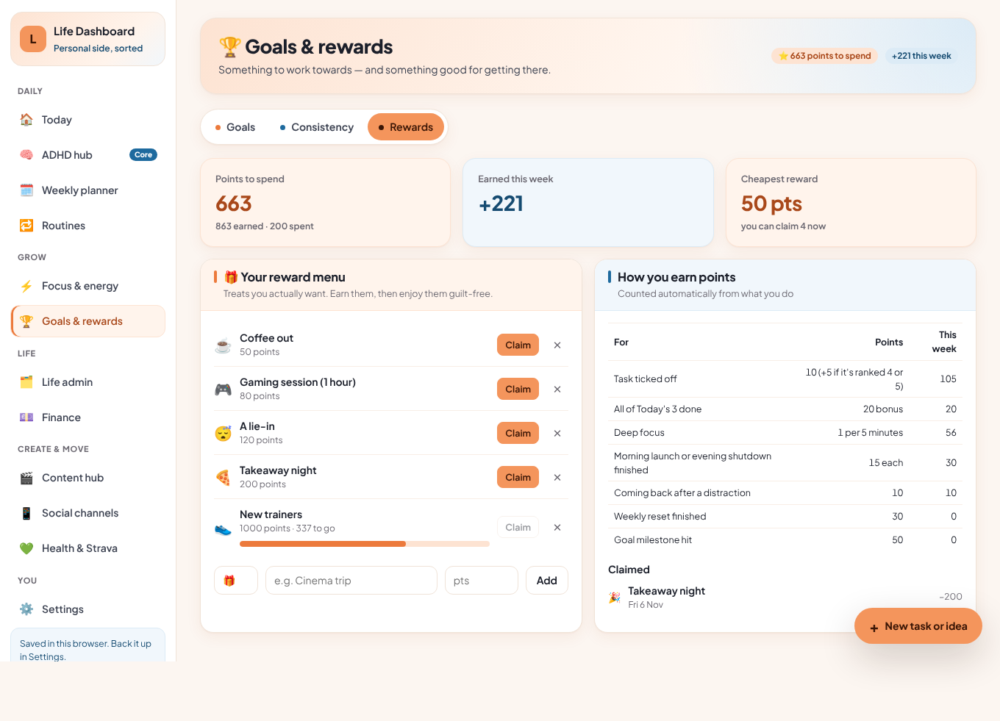 |

### How the weekly numbers are worked out

- **Time saved:** two parts added together.
  - Each idea you park gets credited with the time its effort score says it would have taken (1 = 15 min, 2 = 1h, 3 = 2h, 4 = 4h, 5 = 8h).
  - Plus the time your systems save each week, from **Content hub → Overview → Where the hours come from**.
- **Problems solved:** tasks ticked off this week.
- **Deep focus:** minutes logged with the focus timer.
- **Ideas parked, not chased:** ideas parked this week that are still parked.

| Check-in | Score & sort |
|---|---|
| 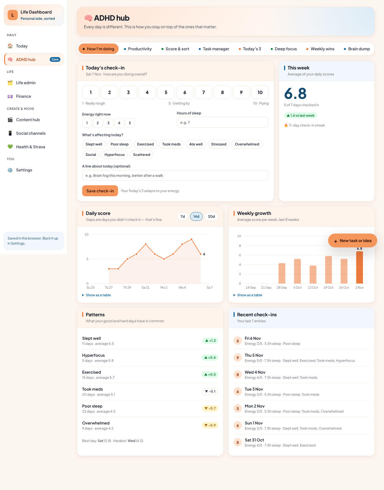 | 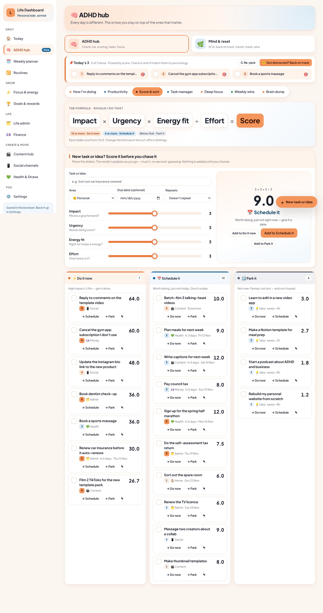 |

| Weekly wins | Deep focus |
|---|---|
| 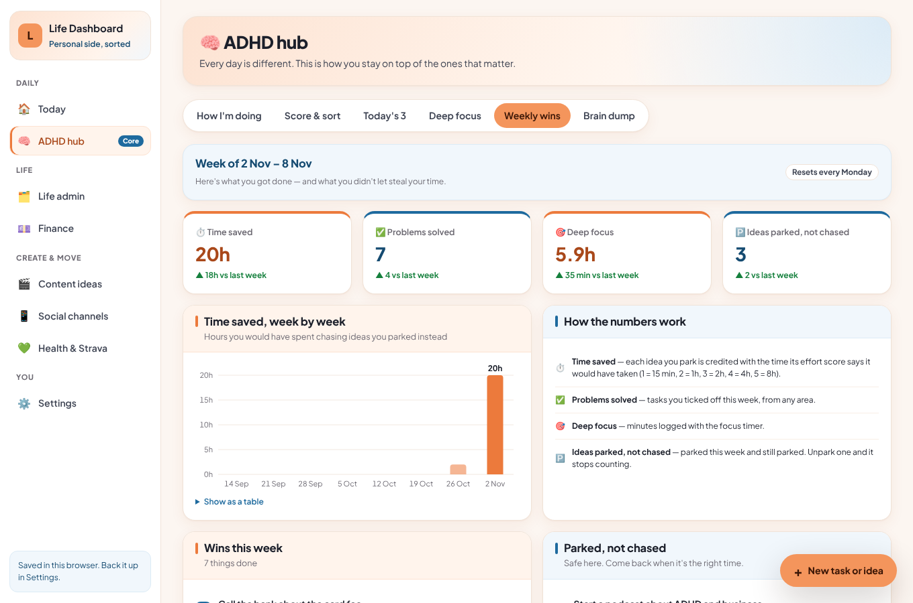 | 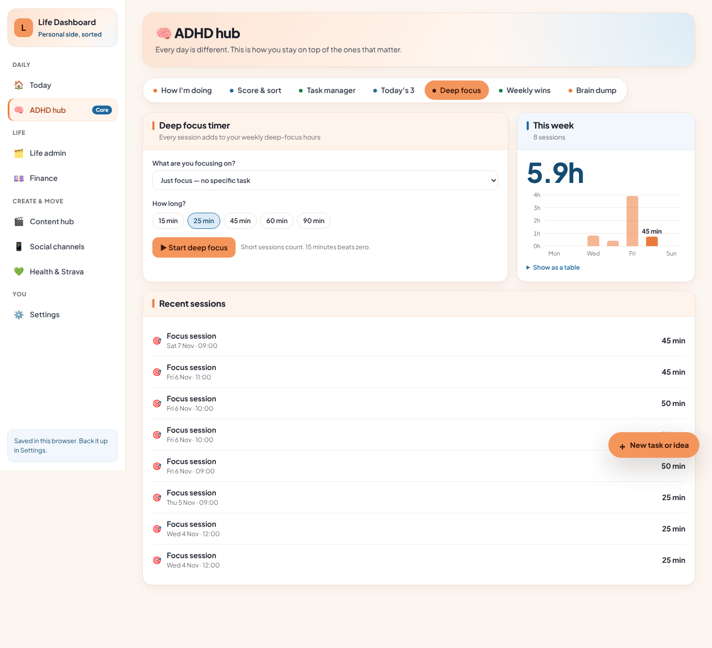 |

## 🗓️ Weekly planner

**Weekly reset** is a guided 20-minute session in 5 steps. On Saturday and Sunday it plans next week; on Monday to Friday it plans the current week.
1. **Look back:** last week's productivity, time saved, problems solved and wins, plus a 3-question reflection.
2. **Clear the decks:** the brain dump count, overdue tasks (move them to next week or park them) and how full Do it now is.
3. **Pick 3 priorities:** choose existing tasks or type new ones, and give each a day. They're ranked 5 and come up in Today's 3 on their day.
4. **Plan the days:** a focus block for each day (e.g. `09:00–10:30`, with your best focus window suggested) and a note. Each day also shows its tasks due, bills and content pillar.
5. **Check your reminders,** then **Finish** (+30 points). Finished resets build a weekly streak.

**This week / Next week** shows the 3 priorities with tick boxes, and a 7-day grid with focus blocks, tasks, bills and pillars. Past days show their productivity score and check-in.

The Today page shows a "plan your week" prompt until the current week's reset is done.

## 🔁 Routines

- **🌅 Morning launch and 🌙 Evening shutdown:**
  - **Steps:** a checklist you can edit, with minutes for each step.
  - **Guided mode:** one step at a time with a countdown.
  - **Consistency:** a 14-day dot strip, a streak, and a "never miss twice" message.
  - **Interactive steps:** check in, see Today's 3, start #1 for 25 minutes, add wins, brain-dump loose ends, and **pick tomorrow's first task** (Today's 3 puts it first tomorrow).
  - **Points:** finishing a routine earns 15.
- **Day timeline:** today hour by hour, with a "now" line. It shows your routines, the focus block from your weekly plan, reminders and your own blocks (gym, appointments), plus what you're in now and what's next. This helps with time blindness.
- **Guess vs actual:** guess how long a task will take, then time it. It learns your real ratio (e.g. "tasks take 1.6× your guess") and tells you how long to plan for 30 minutes.

## ⚡ Focus & energy

- **Check-ins:** rate focus and energy (1–5) any time, in 3 seconds. Over 30 days this builds an **average focus by hour** chart and your **best 3-hour focus window**, which the planner suggests for focus blocks.
- **Log a distraction:** one tap by cause (phone, social media, a new idea, noise, hungry or tired, boredom, stress). **What pulls you away** ranks the causes over 30 days and gives a tip for the biggest one.
- **Hyperfocus guard:** nudges you every 45–120 minutes to drink, stretch and eat while you're locked in.

## 🏆 Goals & rewards

- **Goals:** a goal, why it matters, a deadline and milestones (each with an optional date). Push any milestone into your tasks with **→ Task**. Each milestone hit earns 50 points.
- **Consistency:** "never miss twice" for your routines, check-in, Today's 3 and every daily basic. Each row has 14-day dots and a streak, and it flags anything you missed yesterday so today counts.
- **Rewards:** your own reward menu (coffee out, gaming, takeaway, new trainers…), claimed with points. Points are worked out from what you've done:

  | For | Points |
  |---|---|
  | Each task | 10, +5 if it's ranked 4 or 5 |
  | All of Today's 3 | 20 bonus |
  | Deep focus | 1 per 5 minutes |
  | A finished routine | 15 |
  | A comeback | 10 |
  | A weekly reset | 30 |
  | A milestone | 50 |

## 🔔 Reminders

**Settings → Reminders** has six nudges you can switch on or off, each with its own time and days:
- morning launch;
- medication (off by default);
- "How's #1 going?";
- afternoon reset;
- evening shutdown;
- the Sunday weekly reset.

How they reach you:
- **📲 Add to my phone's calendar** downloads a `.ics` file of repeating events with alerts. Open it on your phone and tap Add, and your phone buzzes even when the dashboard is closed. If you change the times, download it again and remove the old events.
- **Browser notifications** (and a message on screen) also fire while the page is open.
- Once the dashboard is live, Claude notifications can take over.

## The other sections

- **🗂️ Life admin:** home, admin and money tasks, grouped into overdue, today, next 7 days, later and no date. Tasks can repeat weekly, monthly or yearly, and the next one is created when you tick one off. Bills from Finance show here too.
- **💷 Finance:** money in and out, monthly budgets for each category (with warnings at 85% and when you go over), a 6-month spending trend, bills and subscriptions by the day they come out, and savings goals.
- **🎬 Content hub:** four tabs.
  - **Overview:**
    - Tiles for views last week, posts out last week and hours saved on content.
    - A 12-week views chart with last week highlighted. You log weekly views from your platforms' analytics.
    - **Where the hours come from:** each content job's time before and now and how often you do it, giving the hours saved a week.
  - **Strategy:**
    - *The big picture:* who you are, who it's for, what you sell, how you sound, your 90-day goal, and your always/never rules.
    - *Content pillars:* each with its share of your content.
    - *Pillar balance:* what you actually posted in the last 30 days compared with your plan.
    - *Posting plan:* posts per week on each platform.
    - *Weekly rhythm:* one pillar for each day.
  - **Ideas:** get 3 ideas at a time (today's pillar is picked for you), each with a hook, format and call to action. The board takes each idea from Idea → Scripted → Filmed → Posted, and every idea has its own 1–5 bar, so each column is ranked.
  - **Content tasks:** the content task manager.
- **📱 Social channels:** every channel with its follower count, change over 30 days, a sparkline, and posts this week.
- **💚 Health & Strava:** weekly distance for the last 8 weeks, recent activities, daily basics (habits you choose) and average sleep taken from your check-ins.
  - **To import Strava:** go to Strava → Settings → My Account → *Download or delete your account* → request your archive. Then import `activities.csv`. Activities you've already imported are skipped.

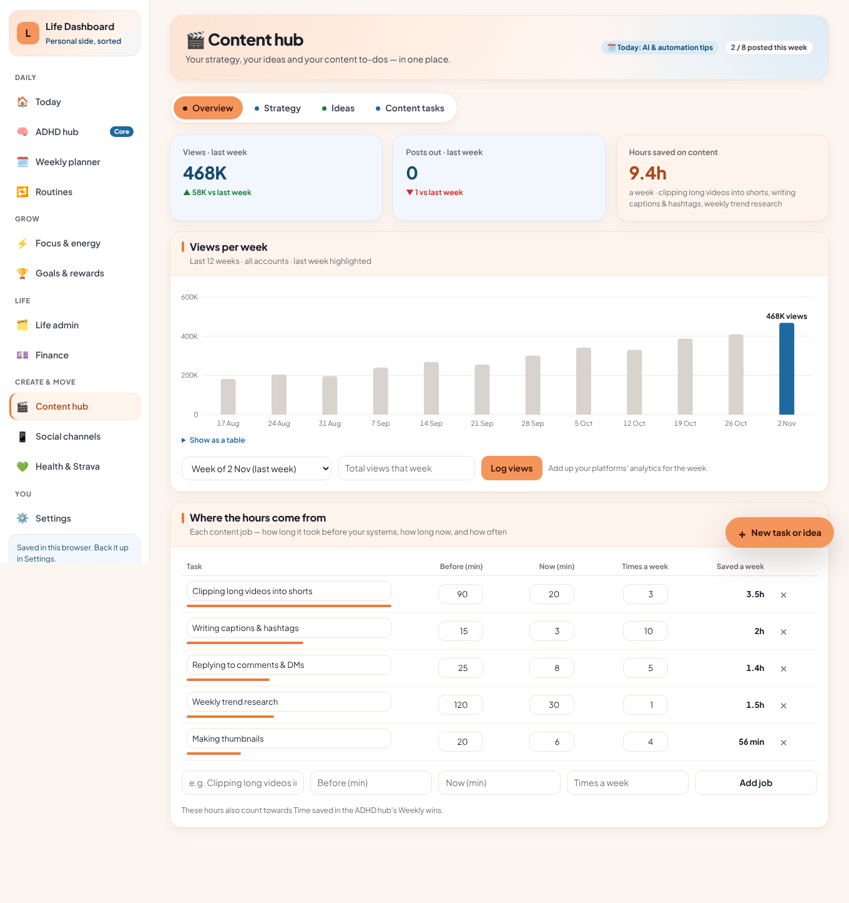

| Content hub → Strategy | Content hub → Ideas |
|---|---|
| 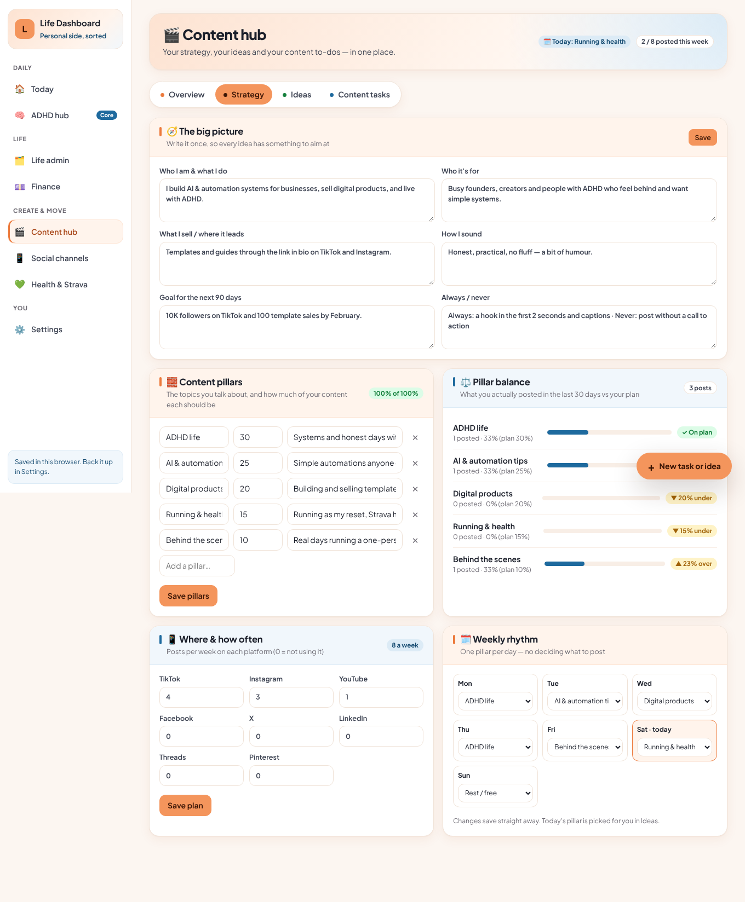 | 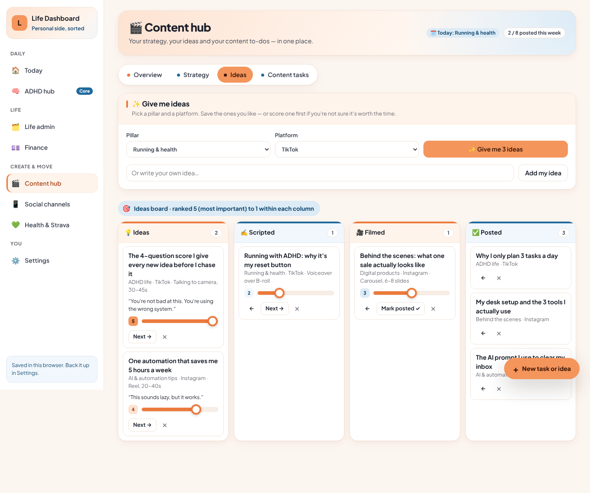 |

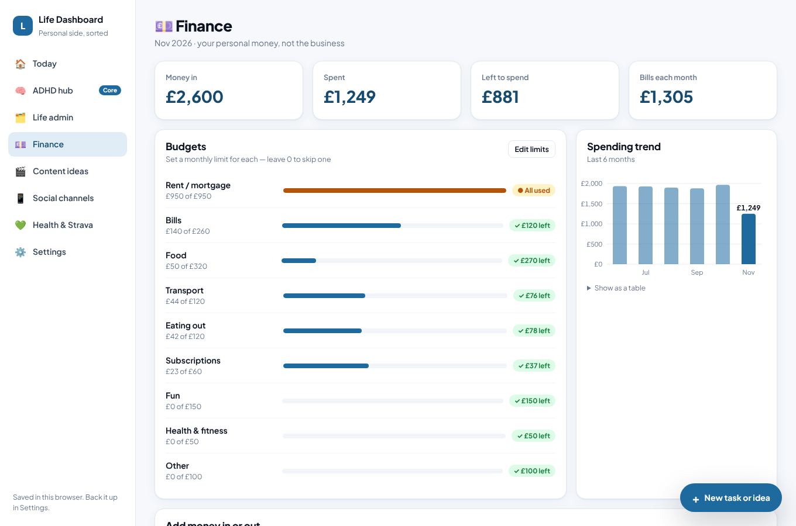

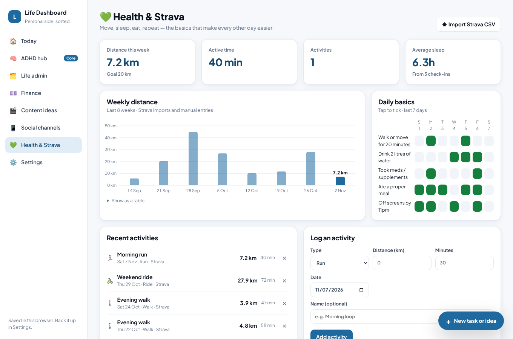

## Next steps

1. **Live Strava.** Strava's secure sign-in needs a server, so add it to the server with an automatic weekly import.
2. **Automatic follower counts.** Feed the API hub from a Metricool or Zapier automation, so linked channels update with no typing.
3. **Bank feed.** Use open banking, or import a bank CSV, so you don't have to type in what you spend.
4. **AI content ideas.** Use the assistant (the same Claude set-up as Content Studio) for ideas written in your own voice.
5. **Claude notifications.** Once it's live, push reminders and summaries (Today's 3 in the morning, weekly wins on Sunday) can replace the calendar file.
